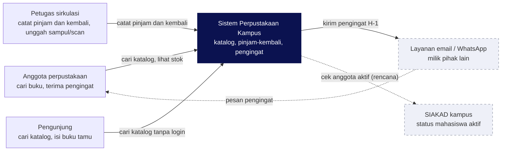
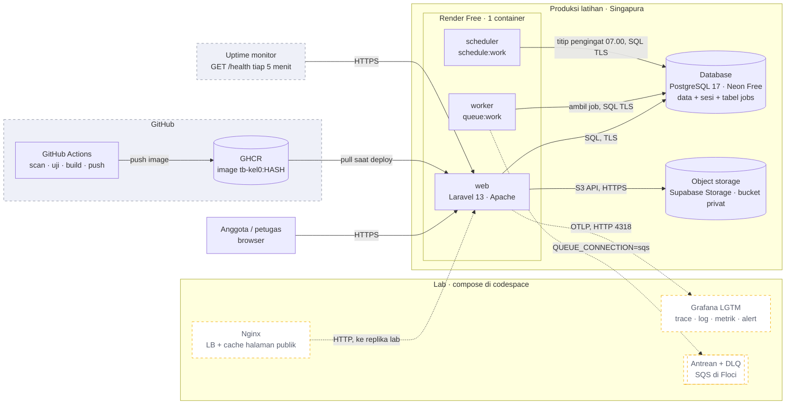
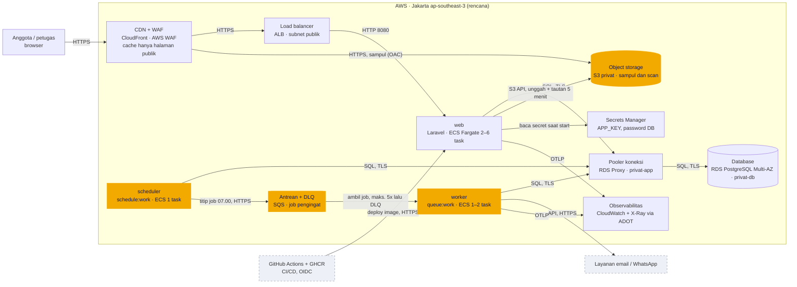
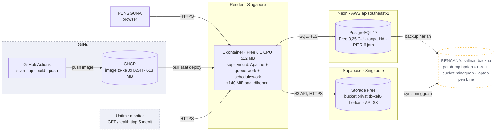
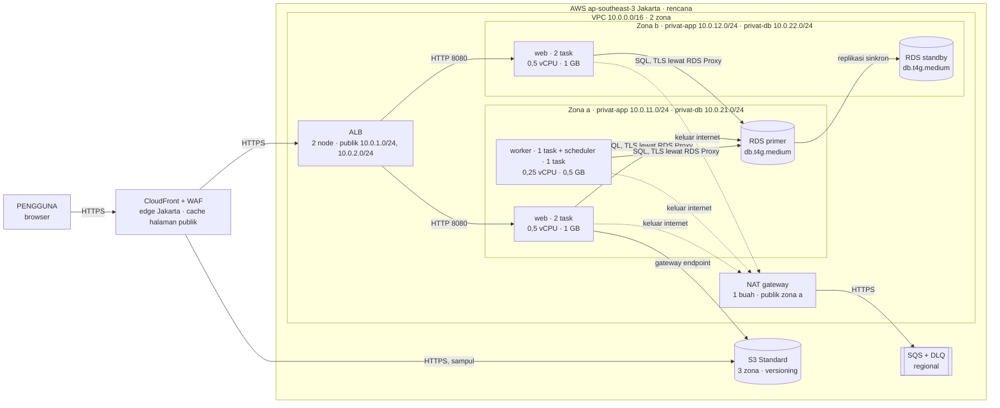
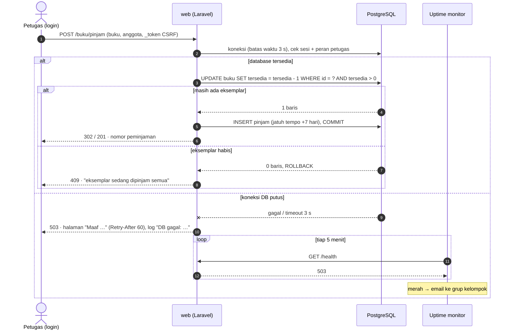
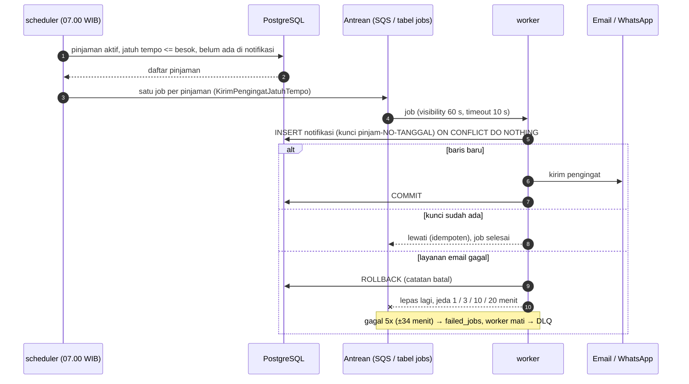

# Arsitektur · Perpustakaan Kampus (Kelompok 0) · v3 final · 2026-11-20

Perpustakaan pusat kampus swasta (±6.000 mahasiswa, ±300 dosen dan staf)
memindahkan katalog, pinjam-kembali, dan pengingat jatuh tempo ke aplikasi
web. Penggunanya anggota (cari buku, terima pengingat), petugas sirkulasi
(catat pinjam dan kembali, unggah sampul/scan), dan pengunjung (katalog,
buku tamu). Masalah utamanya: katalog tidak bisa dicari dari luar
perpustakaan, stok sering selisih, dan anggota lupa tanggal kembali. Beban
naik ±5× di minggu ujian.

Dokumen terkait: [kebutuhan](kebutuhan.md) · [keputusan](keputusan.md) ·
[komponen](komponen.md) · [jaringan](jaringan.md) · [evaluasi](evaluasi.md)
· [ADR](adr/) · [infra/](../infra/README.md)

Riwayat: v1 (P9, satu container web PHP), v1.1 (P12, pindah ke Laravel:
web + worker + scheduler dari satu image, ADR 0004), v2 (P14, komponen
target lengkap), v3 (P15, deployment diagram + evaluasi) tersimpan di
riwayat Git file ini.

## Ringkasan: yang berjalan vs rancangan target

| Aspek | Berjalan sekarang (tanpa kartu kredit) | Target 10.000 pengguna (rencana) |
|-------|----------------------------------------|----------------------------------|
| Compute web | Render Free, 1 container (Apache + worker + scheduler, `JALANKAN_WORKER=1`), Singapura | ECS Fargate web 4 × 0,5 vCPU/1 GB, 2 zona, auto scaling 2–6 |
| Worker + scheduler | di container Render yang sama (supervisord); tidur bersama web | ECS service worker 1–2 × 0,25 vCPU, scheduler 1 × 0,25 vCPU |
| Antrean job | tabel `jobs` di Neon | SQS + DLQ (`infra/antrean`, diuji di Floci) |
| Database | Neon Free PostgreSQL 17, URL pooled, PITR 6 jam (data + sesi + antrean) | RDS PostgreSQL 17 Multi-AZ db.t4g.medium + RDS Proxy |
| Berkas (sampul, scan) | **Supabase Storage** Free, bucket privat, API S3 | S3 privat + CloudFront (sampul); scan lewat tautan bertanda tangan |
| CI/CD | GitHub Actions → GHCR → deploy hook Render (bila diaktifkan) | sama; deploy ke ECS lewat OIDC (tanpa access key) |
| Observabilitas | uptime monitor ke `/health`; OTel → Grafana LGTM **hanya di lab** | ADOT/OTel → CloudWatch + X-Ray, alarm SLO, uptime monitor |
| Keamanan | HTTPS Render, HSTS + CSP dasar, secret di Render *Environment*, scan di CI | + WAF (rate-based), security group berlapis, Secrets Manager, KMS |
| Region data | Singapura (data contoh saja) | Jakarta `ap-southeast-3` (ADR 0003) |

## 1. Diagram konteks (C4 level 1)

## 2. Diagram container (C4 level 2) · yang berjalan sekarang

Kotak kuning bergaris putus-putus belum melayani pengguna: sudah dibuat dan
dites di lab (compose di codespace, Floci), tetapi belum ada di produksi.

## 3. Diagram container (C4 level 2) · rancangan target

Komponen kuning = tambahan P14 untuk berkas dan pengingat (ADR 0005).
Subnet sesuai [jaringan.md](jaringan.md).

## 4. Deployment diagram 1 · berjalan (2026-11-20)

GHCR tidak berada di jalur permintaan pengguna; ia hanya dibutuhkan saat
deploy (dipakai di SPOF, evaluasi.md bagian 1). Supabase hanya di jalur
sampul dan scan; katalog dan pinjam tetap jalan tanpanya.

## 5. Deployment diagram 2 · target multi-AZ (rencana)

Satu NAT gateway sengaja dipilih (hemat ±US$44/bulan): bila zona a mati,
task web di zona b tetap melayani pengguna, tetapi titip/ambil job SQS dan
menarik image baru tertunda sampai NAT pulih; scheduler dan worker
dijalankan ulang ECS di zona b. Trade-off ini ditulis di
[evaluasi.md](evaluasi.md) bagian 6.

## 6. Sequence diagram · pinjam buku (jalur normal dan gagal)

Aksi utama kasus. Nomor langkah dirujuk di postmortem.

## 7. Sequence diagram · pengingat jatuh tempo (event-driven, P14)

## 8. Kebutuhan berangka (ringkas dari kebutuhan.md)
- 1.000 pengguna: 100 bersamaan, 20 req/s, 1 vCPU, 1 GB RAM.
- 10.000 pengguna: 1.000 bersamaan, 200 req/s; Laravel ±14 ms CPU per
  request (bagian 6) → 4 task web × 0,5 vCPU **bila** halaman publik
  di-cache CDN (±67 req/s ke aplikasi), maks 6 task tanpa cache; database
  2 vCPU dengan pooler; object storage 29 GB.
- Target: uptime 99,5% (sekarang) dan 99,9% (target); p95 katalog < 1 s
  pada 100 VU (terukur 49 ms); RPO ≤ 24 jam / RTO ≤ 4 jam (sekarang), RPO
  ≤ 5 menit / RTO ≤ 1 jam (target); pengingat ≤ 1 jam terlambat.

## 9. Risiko dan biaya
Rincian di [evaluasi.md](evaluasi.md): SPOF, ketersediaan seri/paralel,
RPO/RTO, pilar Well-Architected, biaya per komponen, dan trade-off.
Ringkasnya:
- **Biaya bulanan:** berjalan US$0 (paket gratis); target satu zona
  ±US$284 (±Rp4,7 juta), multi-AZ ±US$360 (±Rp5,9 juta), dengan jadwal
  skala ±US$322. Komponen termahal: database Multi-AZ (±43%).
- **Risiko utama sekarang:** satu container (web + worker + scheduler) dan
  satu database tanpa standby (SPOF); container tidur saat sepi sehingga
  pengingat bisa terlambat; backup harian belum terjadwal; akun
  Render/Neon/Supabase masing-masing dipegang satu orang.
- **Risiko utama target:** satu region di Indonesia (DR lintas region =
  data keluar negeri, ADR 0006); satu NAT gateway; ukuran compute
  bergantung rasio HIT cache CDN.

## 10. Checklist review diagram (slide 9)
- [x] Judul berisi jenis diagram + versi/tanggal.
- [x] Batas provider, region, zona/environment terlihat.
- [x] Kotak berisi nama + teknologi + angka (replika, ukuran, tier).
- [x] Semua panah berlabel protokol/aksi, satu arah.
- [x] Sistem luar bergaris putus-putus; berjalan vs rencana dibedakan.
- [x] Tanpa host/IP database, password, key, atau connection string.
- [x] Cocok dengan `infra/` (bucket, antrean, database), `deploy/k8s/`
  (web, worker, scheduler) dan yang berjalan (Render + Neon + Supabase).
