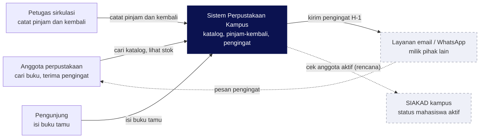
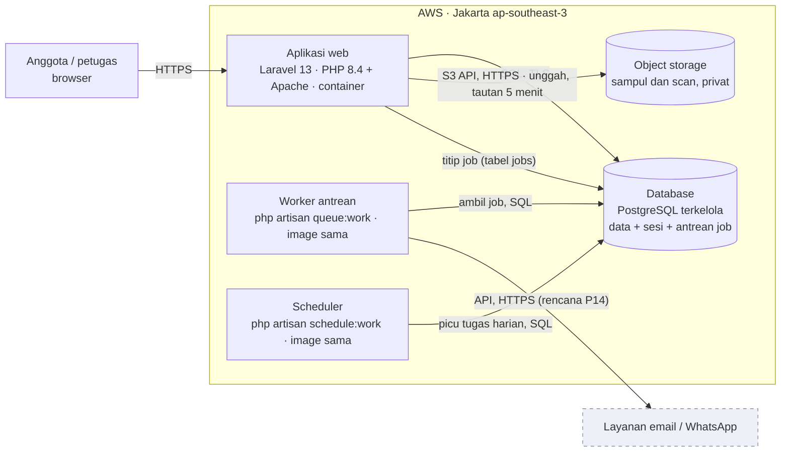

# Arsitektur · Perpustakaan Kampus (Kelompok 0) · v1.1 · 2026-11-10

Perpustakaan pusat kampus swasta (±6.000 mahasiswa, ±300 dosen dan staf)
memindahkan katalog, pinjam-kembali, dan pengingat jatuh tempo ke aplikasi
web. Penggunanya anggota (cari buku, terima pengingat), petugas sirkulasi
(catat pinjam dan kembali), dan pengunjung (buku tamu). Masalah utamanya:
katalog tidak bisa dicari dari luar perpustakaan, stok sering selisih, dan
anggota lupa tanggal kembali. Beban naik ±5× di minggu ujian.

Dokumen terkait: [kebutuhan](kebutuhan.md) · [keputusan](keputusan.md) ·
[ADR](adr/)

Riwayat: v1 (P9, 2026-10-23) memakai satu container web PHP. v1.1 (P12)
setelah pindah ke starter Laravel (ADR 0004): satu image yang sama
dijalankan sebagai tiga container (web, worker, scheduler), ditambah object
storage untuk sampul dan scan.

## 1. Diagram konteks (C4 level 1)

## 2. Diagram container (C4 level 2) · v1.1

Batas sistem = provider dan region dari keputusan.md. Satu image Laravel
(`web/`) dijalankan dengan perintah berbeda: Apache (web), `queue:work`
(worker), `schedule:work` (scheduler). Lingkungan latihan sekarang (Render
+ Neon + Supabase Storage, paket gratis) menjalankan ketiganya di **satu**
container (`JALANKAN_WORKER=1`) dengan data contoh saja (ADR 0003, 0004).

