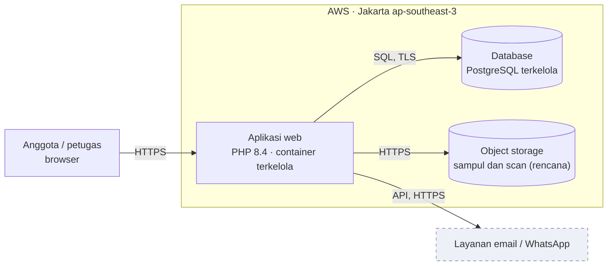

# Arsitektur · Perpustakaan Kampus (Kelompok 0) · v1 · 2026-10-23

Perpustakaan pusat kampus swasta (±6.000 mahasiswa, ±300 dosen dan staf)
memindahkan katalog, pinjam-kembali, dan pengingat jatuh tempo ke aplikasi
web. Penggunanya anggota (cari buku, terima pengingat), petugas sirkulasi
(catat pinjam dan kembali), dan pengunjung (buku tamu). Masalah utamanya:
katalog tidak bisa dicari dari luar perpustakaan, stok sering selisih, dan
anggota lupa tanggal kembali. Beban naik ±5× di minggu ujian.

Dokumen terkait: [kebutuhan](kebutuhan.md) · [keputusan](keputusan.md) ·
[ADR](adr/)

## 1. Diagram konteks (C4 level 1)

```mermaid
flowchart LR
  anggota["Anggota perpustakaan<br/>cari buku, terima pengingat"]
  petugas["Petugas sirkulasi<br/>catat pinjam dan kembali"]
  tamu["Pengunjung<br/>isi buku tamu"]
  sistem["Sistem Perpustakaan Kampus<br/>katalog, pinjam-kembali, pengingat"]
  pesan["Layanan email / WhatsApp<br/>milik pihak lain"]
  siakad["SIAKAD kampus<br/>status mahasiswa aktif"]
  anggota -- "cari katalog, lihat stok" --> sistem
  petugas -- "catat pinjam dan kembali" --> sistem
  tamu -- "isi buku tamu" --> sistem
  sistem -- "kirim pengingat H-1" --> pesan
  pesan -. "pesan pengingat" .-> anggota
  sistem -. "cek anggota aktif (rencana)" .-> siakad
  classDef kita fill:#0B1250,stroke:#0B1250,color:#fff
  classDef luar fill:#EEF0F8,stroke:#8A8FA0,stroke-dasharray: 5 5
  class sistem kita
  class pesan,siakad luar
```

## 2. Diagram container (C4 level 2) · v1

Batas sistem = provider dan region dari keputusan.md. Object storage belum
ada di aplikasi, digambar sebagai rencana. Lingkungan latihan sekarang
(Render + Neon, paket gratis) menjalankan container yang sama dengan data
contoh saja (ADR 0003).

