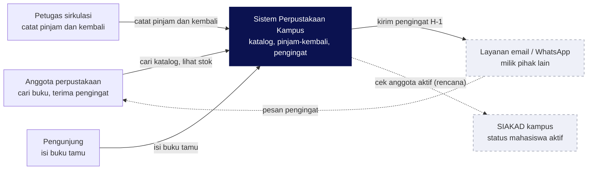
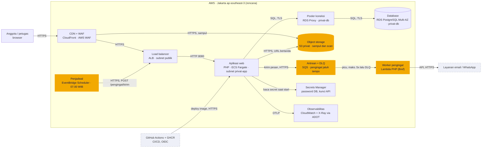

# Arsitektur · Perpustakaan Kampus (Kelompok 0) · v2 · 2026-11-17

Perpustakaan pusat kampus swasta (±6.000 mahasiswa, ±300 dosen dan staf)
memindahkan katalog, pinjam-kembali, dan pengingat jatuh tempo ke aplikasi
web. Penggunanya anggota (cari buku, terima pengingat), petugas sirkulasi
(catat pinjam dan kembali), dan pengunjung (buku tamu). Masalah utamanya:
katalog tidak bisa dicari dari luar perpustakaan, stok sering selisih, dan
anggota lupa tanggal kembali. Beban naik ±5× di minggu ujian.

Dokumen terkait: [kebutuhan](kebutuhan.md) · [keputusan](keputusan.md) ·
[komponen](komponen.md) · [jaringan](jaringan.md) · [ADR](adr/) ·
[infra/](../infra/README.md)

Riwayat: v1 (P9) tersimpan di riwayat Git file ini.

## 1. Diagram konteks (C4 level 1)

## 2. Diagram container v2 (P14)

Komponen kuning = tambahan P14 untuk berkas dan pengingat (ADR 0006).
Subnet sesuai [jaringan.md](jaringan.md); setiap kotak punya baris di
[komponen.md](komponen.md).

